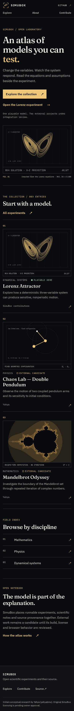
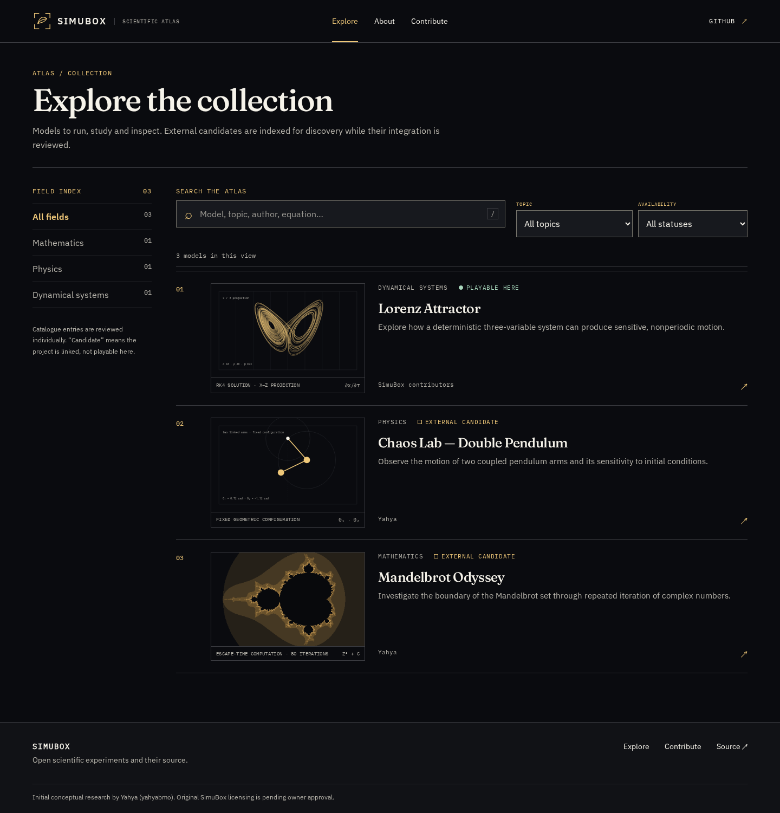
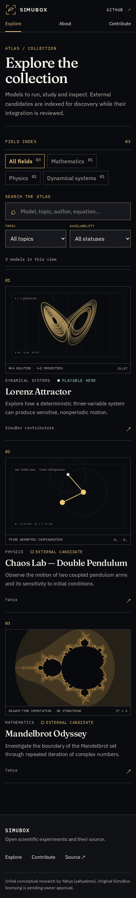
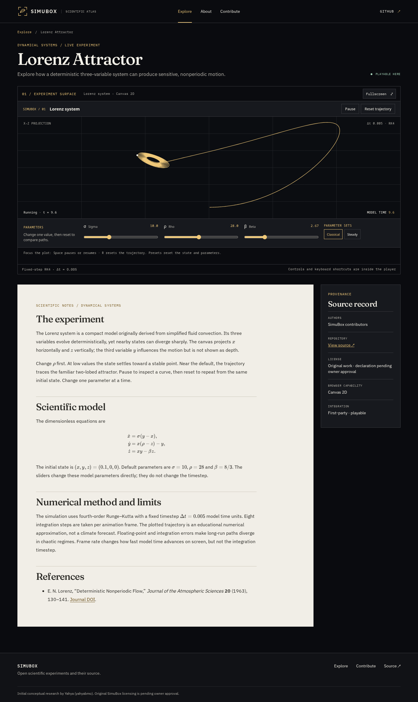
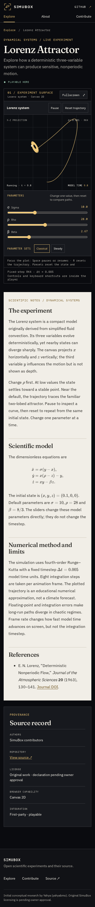

# SimuBox

An interactive scientific atlas: run a model, change its parameters, read its equations and inspect its source. The static platform currently includes one original, playable Lorenz attractor and two clearly identified external candidates, Mandelbrot Odyssey and Chaos Lab.

Mission 007's Scientific Atlas redesign is ready for owner review. The project is not publicly deployed or audited as a production sandbox.

### Actual product screenshots

| Desktop | Mobile |
| --- | --- |
| [](docs/screenshots/home-desktop.png) | [](docs/screenshots/home-mobile.png) |
| [](docs/screenshots/explore-desktop.png) | [](docs/screenshots/explore-mobile.png) |
| [](docs/screenshots/simulation-desktop.png) | [](docs/screenshots/simulation-mobile.png) |

The [external candidate detail](docs/screenshots/candidate-desktop.png) shows the source-only state. Screenshots were captured from the built application.

## Features

- Static Astro catalogue with authentic model previews, field, topic and availability filters, live search, shareable query state, result count and empty state.
- Reusable scientific pages with typeset equations, model explanation, limitations, references, source, authors and license status.
- TypeScript Lorenz model integrated with fixed-step RK4, Canvas 2D trajectory, parameter sets, pause/resume, reset, keyboard shortcuts and fullscreen player.
- Restricted iframe with an opaque origin; separate local player origin during development.
- YAML manifest validation, deterministic preview generation, unit tests, browser and accessibility checks, and trusted CI.

## Requirements and launch

Node.js 24 is recommended; Astro requires Node.js 22.23.4 or newer. npm is included with Node. From the repository root:

```bash
npm ci
npm run dev
```

Open **http://127.0.0.1:4321**. The first-party simulation is served at **http://127.0.0.1:4322** in development. Both services stop with Ctrl+C. No database or credentials are needed.

## Commands

| Command | Purpose |
| --- | --- |
| `npm run dev` | Build the reference simulation and start site plus separate player origin. |
| `npm run validate` | Check manifests, duplicate IDs, content and entry points. |
| `npm run generate:previews` | Regenerate deterministic scientific preview assets. |
| `npm run check` | Astro and TypeScript diagnostics. |
| `npm run lint` | ESLint. |
| `npm run test` | Focused Vitest unit tests. |
| `npm run build` | Validate, bundle simulation and generate static site in `site/dist/`. |
| `npm run preview` | Preview the built site at port 4321. |
| `npm run test:e2e` | Playwright browser tests; first run may need `npx playwright install chromium`. |

## Structure

`site/` holds Astro pages, components, design tokens and scientific Markdown. `simulations/manifests/` is the authoritative metadata; `simulations/lorenz/` separates the numerical model, renderer and controls. `scripts/` builds the first-party asset, generates previews and validates metadata. `tests/` contains unit and browser checks. `docs/` records the [design system](docs/DESIGN_SYSTEM.md), product scope, feasibility, architecture, security and decisions. Fontsource self-hosts Fraunces and IBM Plex families; KaTeX typesets equations at build time; Axe checks page accessibility in browser tests.

## Contributing and security

Open an issue or reviewed pull request with a scientific description, references, author attribution, source URL and license. A valid manifest and scientific note add a catalogue entry. External code stays a candidate until revision, license, dependency, build artifact, browser compatibility and hosting security are reviewed. The current CI never builds third-party repositories. See [simulation contract](docs/SIMULATION_CONTRACT.md), [security model](docs/SECURITY.md) and [contribution page](site/src/pages/contribute.astro).

## Limitations and roadmap

Only the first-party Lorenz simulation plays inside SimuBox. The two external candidates built in a disposable environment but failed the current opaque-origin iframe's module loading; they need further integration review and separate-origin hosting. The production static output needs host-configured CSP and permissions headers before public deployment. User needs are assumptions pending research. See [feasibility](docs/FEASIBILITY.md) and [roadmap](docs/ROADMAP.md).

## Attribution and licensing

Yahya (`yahyabmo`) contributed the initial conceptual research. His [Mandelbrot Odyssey](https://github.com/yahyabmo/the-mandelbrot-set) and [Chaos Lab](https://github.com/yahyabmo/the-double-pendulum) are linked as external candidates and retain their own attribution. Their inspected repository roots declare MIT licenses at the pinned candidate commits. Original SimuBox platform code and educational prose have **no final license declaration yet**; MIT for code and CC BY 4.0 for content are recommendations pending owner approval. Do not assume permission to reuse original SimuBox material under those licenses until that decision is made.
