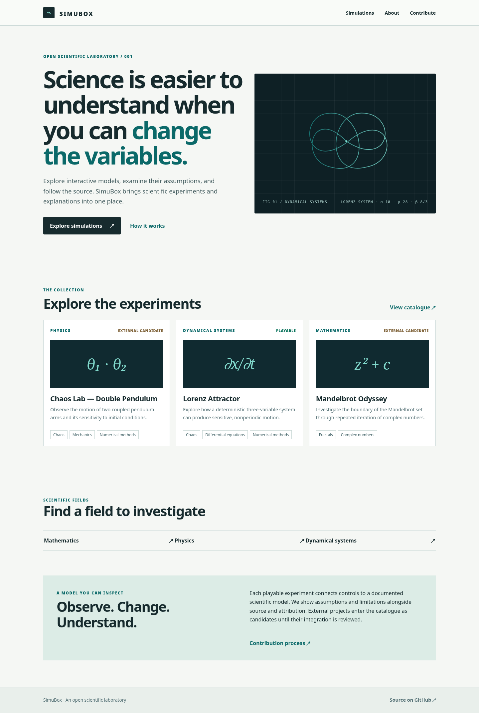

# SimuBox

An open laboratory for exploring scientific models in a browser. The current working foundation offers a searchable catalogue, scientific notes, source provenance and one original interactive Lorenz attractor simulation. Mandelbrot Odyssey and Chaos Lab are clearly marked external candidates; their code is not loaded by SimuBox.

The project is in owner review after Missions 002–005. It is not publicly deployed or audited as a production sandbox.



[Mobile homepage](docs/screenshots/home-mobile.png) · [Lorenz experiment](docs/screenshots/lorenz-desktop.png)

## Features

- Static Astro catalogue with scientific fields, live search, filtering, result count and empty state.
- Reusable simulation pages with model explanation, limitations, references, source, authors and license status.
- TypeScript Lorenz model integrated with fixed-step RK4, Canvas 2D trajectory, parameter controls, pause/resume, reset and fullscreen player.
- Restricted iframe with an opaque origin; separate local player origin during development.
- YAML manifest validation, unit tests, browser tests and trusted CI.

## Requirements and launch

Node.js 24 is recommended; Astro requires Node.js 22.23.4 or newer. npm is included with Node. From the repository root:

```bash
npm ci
npm run dev
```

Open **http://127.0.0.1:4321**. The first-party simulation is served at **http://127.0.0.1:4322** in development. Both services stop with Ctrl+C. No database or credentials are needed.

## Commands

| Command | Purpose |
| --- | --- |
| `npm run dev` | Build the reference simulation and start site plus separate player origin. |
| `npm run validate` | Check manifests, duplicate IDs, content and entry points. |
| `npm run check` | Astro and TypeScript diagnostics. |
| `npm run lint` | ESLint. |
| `npm run test` | Focused Vitest unit tests. |
| `npm run build` | Validate, bundle simulation and generate static site in `site/dist/`. |
| `npm run preview` | Preview the built site at port 4321. |
| `npm run test:e2e` | Playwright browser tests; first run may need `npx playwright install chromium`. |

## Structure

`site/` holds Astro pages, styles and scientific Markdown. `simulations/manifests/` is the authoritative metadata; `simulations/lorenz/` separates numerical model from rendering. `scripts/` builds the first-party asset and validates metadata. `tests/` contains unit and browser checks. `docs/` records product scope, feasibility, architecture, security and decisions.

## Contributing and security

Open an issue or reviewed pull request with a scientific description, references, author attribution, source URL and license. A valid manifest and scientific note add a catalogue entry. External code stays a candidate until revision, license, dependency, build artifact, browser compatibility and hosting security are reviewed. The current CI never builds third-party repositories. See [simulation contract](docs/SIMULATION_CONTRACT.md), [security model](docs/SECURITY.md) and [contribution page](site/src/pages/contribute.astro).

## Limitations and roadmap

Only the first-party Lorenz simulation plays inside SimuBox. External candidates need isolated build and nested-path/iframe testing, artifact validation and separate-origin hosting before integration. The production static output needs host-configured CSP and permissions headers before public deployment. User needs are assumptions pending research. See [roadmap](docs/ROADMAP.md).

## Attribution and licensing

Yahya (`yahyabmo`) contributed the initial conceptual research. His [Mandelbrot Odyssey](https://github.com/yahyabmo/the-mandelbrot-set) and [Chaos Lab](https://github.com/yahyabmo/the-double-pendulum) are linked as external candidates and retain their own attribution. Their inspected repository roots declare MIT licenses at the pinned candidate commits. Original SimuBox platform code and educational prose have **no final license declaration yet**; MIT for code and CC BY 4.0 for content are recommendations pending owner approval. Do not assume permission to reuse original SimuBox material under those licenses until that decision is made.
